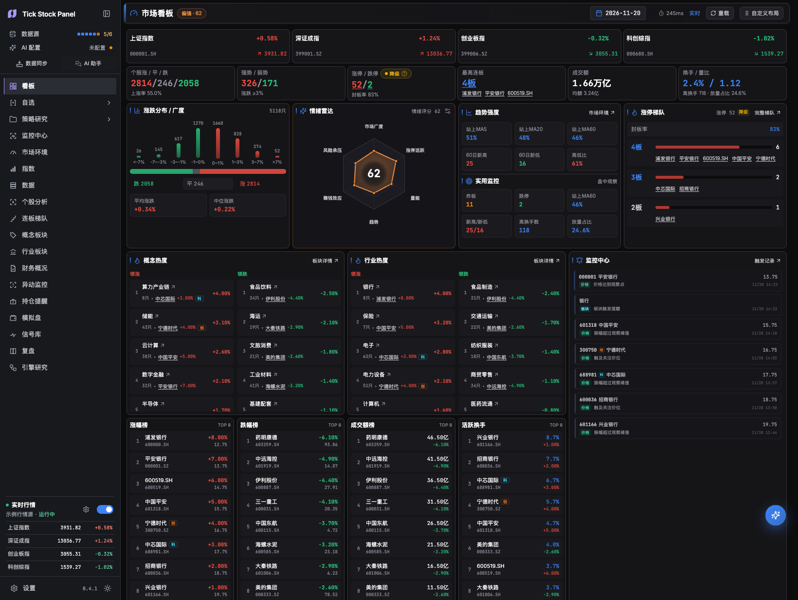
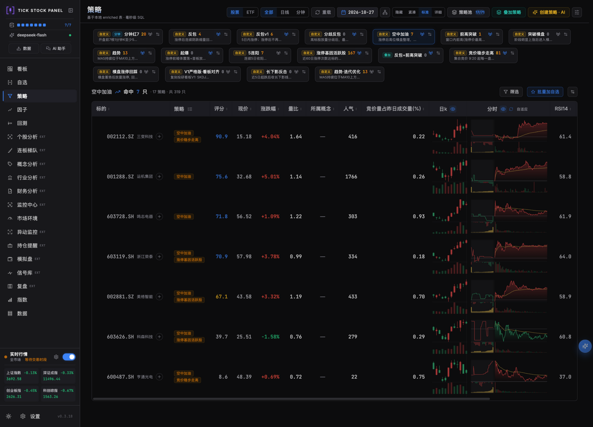
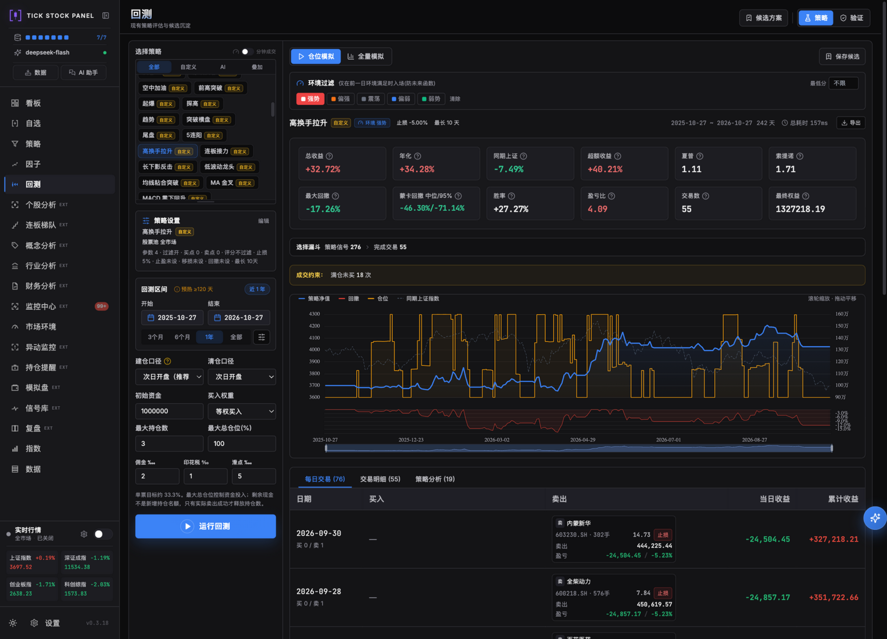
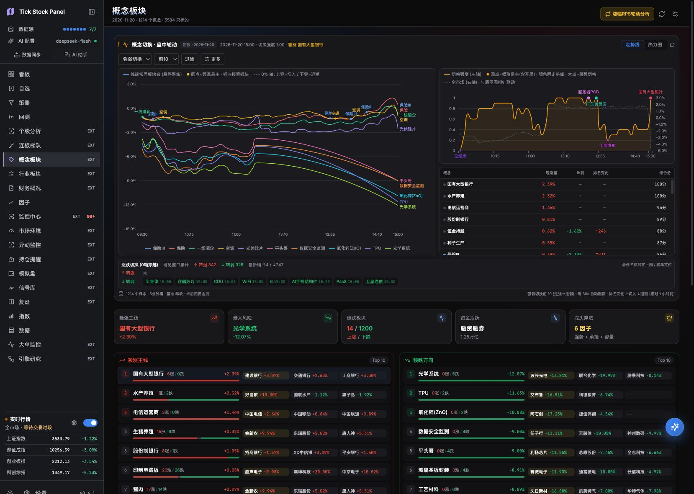
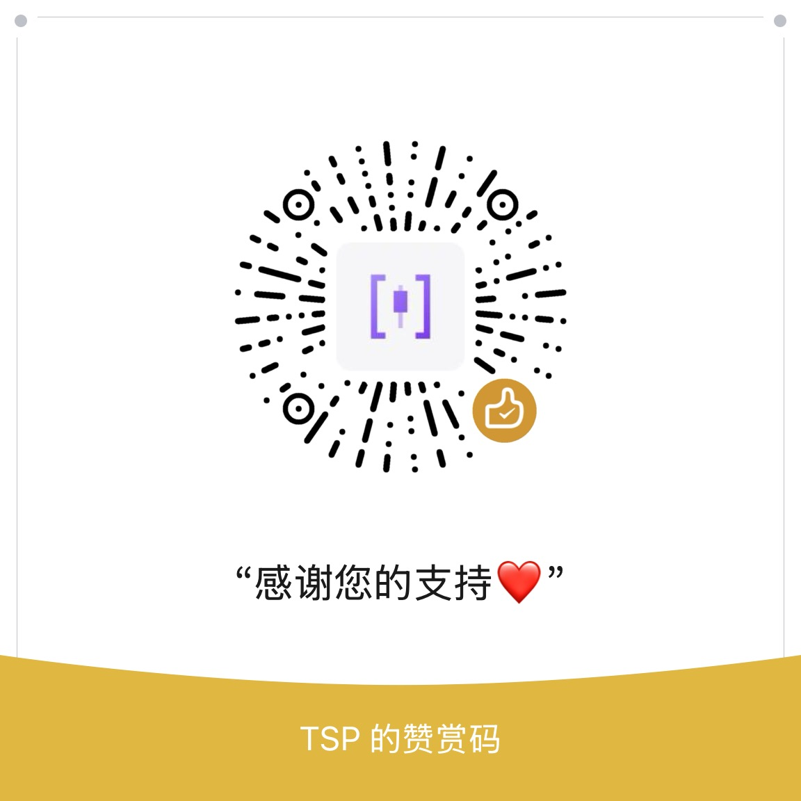

<div align="center">

<a id="top"></a>

# <picture><source media="(prefers-color-scheme: dark)" srcset="./brand/logo-dark-title.svg"></picture> Tick Stock Panel

**自托管 · 零运维 · 核心能力全部开放成接口的可扩展 A 股量化工作台**

[](https://tsp.shy313.com/)

<a href="https://trendshift.io/repositories/64327?utm_source=repository-badge&amp;utm_medium=badge&amp;utm_campaign=badge-repository-64327" target="_blank" rel="noopener noreferrer"></a>
<a href="https://trendshift.io/repositories/64327?utm_source=trendshift-badge&amp;utm_medium=badge&amp;utm_campaign=badge-trendshift-64327" target="_blank" rel="noopener noreferrer"></a>

[](https://github.com/shy3130/tick-stock-panel/actions/workflows/docker.yml) [](https://github.com/shy3130/tick-stock-panel/actions/workflows/ci.yml) [](https://github.com/shy3130/tick-stock-panel/stargazers)

[](./LICENSE) [](https://www.python.org/) [](https://nodejs.org/) [](https://react.dev/) [](./backend/pyproject.toml)

[核心功能](#features)　 **[快速开始](#quick-start)**　 [界面预览](#screenshots)　 [整体架构](#architecture)　 [扩展与导入](#extensions)　 [AI 接入](./docs/ai-integration.md)　 [交流群](#community-group)

</div>

---

<a id="sponsors"></a>


<div align="center">

<a href="https://modelflare.dev/sign-up?partner=CFYSN0AM2APC" target="_blank" rel="noopener noreferrer">
  
</a>

**感谢 [Modelflare](https://modelflare.dev/sign-up?partner=CFYSN0AM2APC) 赞助本项目！** 由美国 Havenbyte LLC 运营，满血稳定不掺水，低成本接入 GPT、Claude、Gemini、Grok 及 40+ 图片/视频模型。指定 OpenAI 分组提供 65% / 75% / 85% 每日缓存命中率保障。单笔充值 US$20 解锁 GPT 0.015x，US$50 解锁 Claude 0.03x。支持大陆正规商务合作。**[专属链接注册 →](https://modelflare.dev/sign-up?partner=CFYSN0AM2APC)**

---

<a href="https://www.runninghub.ai/zh-cn/call-api?source=github&inviteCode=edt5wh7c" target="_blank" rel="noopener noreferrer">
  
</a>

**本项目由赞助商 [RunningHub](https://www.runninghub.ai/zh-cn/call-api?source=github&inviteCode=edt5wh7c) 提供支持** · 一个 API Key 直连 400+ 主流大模型 · **[立即免费测试 →](https://www.runninghub.ai/zh-cn/call-api?source=github&inviteCode=edt5wh7c)**

</div>

---

<a id="project-scope"></a>

> [!IMPORTANT]
> **TSP 面向本地量化学习与研究。** 项目走独立的研究工作台路线，不对标同花顺、通达信等投资及看盘软件。AI 助手用于取数、分析和策略研究，产品范围不含 AI 荐股与涨停预测。行情数据可通过插件接入第三方来源。

<a id="screenshots"></a>
<a id="-界面预览"></a>
<a id="工作台预览"></a>
<a id="工作台"></a>

## 界面预览

<!-- 宽度按各截图的宽高比换算，使预览等高。 -->
<table width="100%" aria-label="界面预览">
  <tr>
    <td width="50%" align="center" valign="top">
      <strong>首页</strong><br>
      <a href="./screenshots/看板.png"></a>
    </td>
    <td width="50%" align="center" valign="top">
      <strong>策略</strong><br>
      <a href="./screenshots/策略.png"></a>
    </td>
  </tr>
  <tr>
    <td width="50%" align="center" valign="top">
      <strong>回测</strong><br>
      <a href="./screenshots/回测.png"></a>
    </td>
    <td width="50%" align="center" valign="top">
      <strong>概念分析</strong><br>
      <a href="./screenshots/概念分析.png"></a>
    </td>
  </tr>
</table>

首页截图使用演示行情。 [浏览全部界面](./screenshots/README.md)

<a id="features"></a>
<a id="-核心功能"></a>
<a id="工作台能力"></a>
<a id="在工作台做什么"></a>
<a id="why-tsp"></a>
<a id="-为什么做-tsp"></a>

## 核心功能

### 自由扩展

日 K、分钟 K、实时行情和除权因子可分别选择数据源。扩展表支持定时拉取、历史回补和 API 写入，字段可供信号、因子及回测使用。在「设置 → 导入与备份」安装数据源和页面插件，导入策略、信号、因子与图表指标。扩展页面可以和内置页面一起分组、排序。[数据源配置](./docs/configuration.md) · [扩展与导入](#extensions)

### 二次开发

用 **Page Pack SDK** 开发自有页面，复用工作台的行情接口和公共个股详情，打包上传后刷新即可使用。源码扩展可注册路由和导航，在个股详情、自选页等已开放的插槽添加组件。后端支持注册独立接口、启动钩子和通知格式化器，也可以编写自定义仓位策略。[页面 SDK](./docs/page-sdk.md) · [二次开发指南](./docs/secondary-development.md)

脚本和外部 AI 可通过 **Open API 或 MCP** 按权限读取行情、查询策略和提交回测。[AI 接入指南](./docs/ai-integration.md)

### 自研 Tivelo 引擎

- **Tivelo Data** 负责采集、校验和发布数据版本，可把日 K 与复权因子固定为快照，供策略复跑和归档研究使用。[数据引擎](./packages/tivelo-data/README.md)
- **Tivelo Backtest** 为工作台的日线、分钟策略和组合回测提供撮合与记账，按 A 股 T+1、涨跌停和交易费用等约束模拟成交。[回测引擎](./packages/tivelo-backtest/README.md)

两个引擎都提供 Python 库和命令行入口。工作台普通回测支持前复权和后复权，启用并授权 Tivelo Pro 后，A 股日线策略还可直接选择动态复权。[快照回测](./docs/engine-platform/workbench-research-jobs.md#用本地日k生成快照并回测) · [动态复权](./docs/engine-platform/workbench-research-jobs.md#动态复权扩展)

### 策略研究与盘中使用

| 功能 | 支持的操作 |
| :--- | :--- |
| **看板与个股分析** | 从榜单、连板梯队和板块成分打开个股，查看市场情绪与板块主线，配置日 K、分时指标和信息条。[市场阶段与主线](./docs/market-phase.md) · [图表指标](./docs/custom-chart-indicators.md) |
| **因子与策略** | 自定义因子并做检验、组合和挖掘，用自定义信号与策略筛选股票池。[因子与策略挖掘](./docs/mining.md) · [策略指南](./docs/strategy.md) |
| **回测验证** | 调整撮合费用、滑点和风控，进行参数筛选和滚动样本外验证，复核净值、成交和回测证据。[报告与证据](./docs/backtest-evidence.md) |
| **监控与模拟盘** | 设置价格、信号和策略告警，把策略绑定到模拟账户，跟踪订单、持仓和成交。[监控规则](./docs/features.md#-监控中心monitor) · [模拟执行](./backend/app/custom/paper_execution/README.md) |
| **工作台 AI 助手** | 在面板内查询本地行情、起草策略和运行回测。[助手与开放接口](#open-api) |

<a id="quick-start"></a>
<a id="-快速开始"></a>
<a id="install-image"></a>

## 快速开始

Docker 可直接运行工作台。行情、策略和用户配置保存在当前目录的 `data/`。

```bash
docker run -d --name tsp -p 3018:3018 \
  -e DATA_DIR=/app/data -v "${PWD}/data:/app/data" \
  ghcr.io/shy3130/tick-stock-panel:latest
```

打开 [localhost:3018](http://localhost:3018)。

<a id="install-desktop"></a>
<a id="install-compose"></a>
<a id="install-dev"></a>
<a id="configuration"></a>
<a id="️-配置"></a>
<a id="-配置"></a>

| 启动方式 | 操作 |
| :--- | :--- |
| 桌面版 | 从 [Releases](https://github.com/shy3130/tick-stock-panel/releases/latest) 下载对应平台的安装包 |
| Docker Compose | 在项目目录执行 `docker compose up --build`，按部署指南配置数据挂载 |
| 源码运行 | 安装 Python 3.11+、Node.js 20+、uv 和 pnpm，再运行 `./dev.sh` 或 `.\dev.ps1` |

[部署、升级与低配环境](./docs/deployment.md)　 [配置说明](./docs/configuration.md)　 [访问密码](./docs/deploy-password.md)

<a id="install-ai"></a>

<details>
<summary>交给本机 AI 助手部署</summary>

> 请克隆 https://github.com/shy3130/tick-stock-panel，优先通过 Docker 镜像部署。需要从源码运行时，按项目部署指南启动。为数据目录设置持久化，启动后告诉我访问地址及首次配置入口。

</details>

### 第一次使用

1. 在「设置 → 数据源」选来源并检测能力。
2. 在「数据」同步日 K 和指标。需要分钟策略时，同步对应的分钟历史。
3. 创建或导入策略，先筛选，再选区间回测并保存候选。
4. 把通过验证的规则用于监控或模拟盘。外部客户端通过「设置 → 开放接口」获取对应权限的 Token。

<a id="architecture"></a>
<a id="-架构"></a>
<a id="️-架构"></a>
<a id="架构与运行流程"></a>
<a id="组件架构"></a>

## 整体架构

[](./assets/readme/architecture-overview.svg)

<a id="workbench-engine"></a>

**TSP 工作台**通过登录会话管理数据源、策略和研究任务。脚本和 MCP 按 Token 权限访问开放接口。数据源、扩展表、策略与信号、页面和后端模块通过各自的契约接入工作台。[扩展与导入](#extensions) · [开放接口](#open-api)

<a id="data-engine"></a>
<a id="backtest-engine"></a>

**Tivelo Data** 负责数据校验、版本发布和快照，**Tivelo Backtest** 负责应用交易规则、模拟撮合与账户记账。两者也可通过 Python 库或命令行独立使用。[数据与市场契约](./docs/engine-platform/data-and-market-contracts.md)

<a id="architecture-flows"></a>

### 数据与执行流程

[](./assets/readme/architecture-flows.svg)

普通策略回测使用工作区里的策略。A 股前复权日线回测可选用已发布的日 K 快照，启用回测过滤时会记录所用扩展数据版本。归档研究会先检查匹配的数据快照和策略归档，再提交任务。[用快照跑回测](./docs/engine-platform/workbench-research-jobs.md#用本地日k生成快照并回测)

<a id="performance"></a>
<a id="-性能"></a>

### 计算内核与性能

行情整理、指标与因子计算、回测面板准备使用 **Polars 1.44 的 Rust 列式内核**。在支持 Numba 的环境中，部分回测矩阵的滚动和递推算子使用 JIT 加速。

同机、同策略的 **15 组参数网格 A/B 基准**中，逐组独立准备与共享行情面板、矩阵编码的总耗时分别为 **19.47 秒和 6.19 秒**。两组均计入数据准备，共享后的耗时减少约 **68%**，逐笔成交及统计结果一致。[基准记录](./docs/ext-architecture-plan.md#p2a-实测2026-10-26-本机-consolidation_limit_pullback-15-组参数网格)

[技术栈与模块边界](./CONTRIBUTING.md#2-项目架构)　[引擎扩展与授权](./docs/engine-platform/extensions-and-releases.md)

<a id="extensions"></a>
<a id="开发与导入扩展"></a>

## 扩展与导入

在「设置 → 导入与备份」预览、确认资源包。源码扩展可使用前端插槽和后端注册接口。

| 要扩展什么 | 支持的接入方式 |
| :--- | :--- |
| [行情来源](./docs/plugin-development.md) | 声明 HTTP YAML，或安装根目录含 `plugin.yaml` 的 Provider ZIP |
| [扩展数据](./docs/extension-packages.md#单个扩展数据配置分享) | 导入单表配置，接入自有字段、回补和更新规则 |
| [策略、信号和因子](./docs/strategy.md#资源导入与批量导出) | 导入策略源码、定义 JSON 或带依赖的资源 ZIP |
| [图表和信息条](./docs/custom-chart-indicators.md) | 导入 `tick-chart-indicators` JSON，用公式及扩展字段定义日 K、分时和信息条 |
| [页面与菜单](./docs/page-sdk.md) | 配置分析页面或导入 `.js`／`.mjs`／`.tsx` 页面，再调整菜单分组、显隐和顺序 |
| [后端插件和仓位规则](./docs/secondary-development.md#4-后端扩展规范) | 导入带 `extension.yaml` 的后端 ZIP 后重启，在「定义目录」管理仓位算法 |
| [引擎扩展](./docs/engine-platform/extensions-and-releases.md) | 导入签名引擎 ZIP，在「已安装扩展」检查兼容性并启用 |

配置备份可迁移策略、偏好和扩展表配置。外部插件和引擎扩展用 ZIP 管理。

[导入格式与兼容性](./docs/extension-packages.md)　 [二次开发指南](./docs/secondary-development.md)

<a id="open-api"></a>
<a id="-开放能力open-api--mcp"></a>
<a id="ai-与开放接口"></a>

## AI 助手与开放接口

<a id="assistant"></a>
<a id="-ai-对话助手"></a>

- **工作台助手。** 用 `⌘K`／`Ctrl+K` 打开，可取数、起草策略和运行回测。写入由确认设置控制。
- **Open API 与 MCP。** 外部脚本和 AI 客户端可按权限访问行情、策略、扩展表与回测。

[AI 接入指南](./docs/ai-integration.md)　 [Open API 示例](./examples/open-api/README.md)　 [MCP 配置](./mcp-server/README.md)　 [策略自动迭代](./docs/strategy-iteration.md)

<a id="documentation"></a>
<a id="-完整文档"></a>
<a id="roadmap"></a>
<a id="️-路线图"></a>

## 文档与社区

[操作说明书](./操作说明书.md)　 [功能手册](./docs/features.md)　 [完整文档索引](./docs/README.md)　 [0.4.1 版本说明](./docs/release-v0.4.1.md)　 [贡献指南](./CONTRIBUTING.md)　 [版本记录](https://github.com/shy3130/tick-stock-panel/releases)

<a id="community"></a>
<a id="️-支持与交流"></a>
<a id="-支持与交流"></a>
<a id="支持与交流"></a>
<a id="社区"></a>

<details>
<summary>交流群与微信赞赏</summary>

<a id="community-group"></a>


</details>

联系邮箱 shy3130@qq.com。[项目网站](https://tsp.shy313.com/)　 [LINUX DO 社区](https://linux.do)

<a id="license"></a>
<a id="-license"></a>
<a id="许可"></a>
<a id="disclaimer"></a>
<a id="️-免责声明"></a>

## 许可与数据

TSP 工作台采用 [MIT 许可](./LICENSE)。分发副本或实质部分须保留原版权声明和许可文本。贡献请遵循 [CONTRIBUTING.md](./CONTRIBUTING.md) 的 DCO 和贡献再许可条款。

**Tivelo 组件按各自制品授权。** 采用 PolyForm 非商业许可的 Tivelo 自有实现，许可范围外的商用须另获权利人书面授权。已授予的 MIT 权利继续有效，适用范围见制品随附的 LICENSE、LICENSE-MIT 和 NOTICE。应用内可在首次配置的「查看软件许可」或「设置 → 关于 → 查看许可」查看许可声明。[PolyForm Noncommercial License 1.0.0](https://spdx.org/licenses/PolyForm-Noncommercial-1.0.0.html)

本项目仅供学习与量化研究，回测结果不代表未来收益，不构成投资建议。使用数据前请阅读供应商条款。[TickFlow](https://tickflow.org/auth/register?ref=V3KDKGXPEA) · [fuyao](https://fuyao.aicubes.cn/docs/api-reference/) · [TdxQuant](https://help.tdx.com.cn/quant/)
