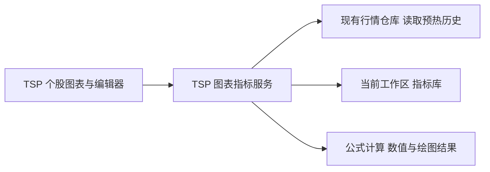

# TSP 自定义图表指标最小接入方案

以下记录源自 v0.3.38 阶段的指标接入，兼容层沿用至当前候选工作区。用户操作与公式范围以[自定义图表指标](custom-chart-indicators.md)为准。个股详情使用 `codex/custom-chart-indicators` 工作快照 `d5f2ab3a` 的图表布局。宽屏下，视图和区间选择位于顶栏右侧，窄屏时可换行。日 K 和单日分时在宽屏共享标题、指标栏和读数的行高，每张图的价格主图下方绘制一条共用时间轴。TSP 提供已加载的行情和配置，公式计算只接收 K 线、周期及参数，返回数值序列和绘图指令。数据源、回测任务和商业价格视图由各自的现有入口管理。

候选已按下述边界接入。图表入口、公式用法和文件迁移步骤见[自定义图表指标用户指南](custom-chart-indicators.md)。

## 兼容性

`codex/custom-chart-indicators` 的分支指针停在 v0.3.37 的 `f9cb383c`。完整的未提交指标改动保存在 `d5f2ab3a`。整份改动还包含旧回测、策略种子等变更，对候选代码做整包应用检查时有 8 处文件冲突。接入从候选工作区出发，按表提取指标相关代码。

| 能力 | 接入方式 |
| --- | --- |
| 通达信风格明文公式、常见均线和窗口运算 | 复用 `tdx_syntax.py`、`tdx.py` 和 `chart.py`。原草稿已有参数、依赖列校验、绘图指令和计算限制。支持的语法以解析器白名单为准。 |
| 公式编辑、校验预览、参数、显隐和排序 | 复用 `IndicatorManager`、配置模型和独立的日 K／分时方案。 |
| 主图叠加、副图、图形标记和量比 | 复用 `CustomDaily`、`CustomIntraday` 和绘图组件。主图、时间轴和公式副图在同一个 Lightweight Charts 图表中绘制。已有方案按原样读取。工作区未保存过指标方案时，日 K 显示默认 MA 和成交量。内置指标列表及默认方案复用同一组公式。[现有调用链](stock-detail-lightweight-charts-plan.md) |
| 旧表达式指标和参数 | 适配候选版仅接收 `text` 的 `compile_formula()`。草稿会传入行情字段、参数和别名，直接接上会因签名不符报错。 |
| 历史预热和行情缓存 | TSP 行情仓库提供只读历史版本。无法取得可靠版本时，指标服务直接读取预热历史。 |
| 指标包分享和配置恢复 | 复用草稿的 JSON 格式、校验、导出和冲突预览。补齐候选版导入中心的格式识别，以及配置恢复对指标段的校验。 |

## 模块边界



服务负责接收界面请求、读取预热历史和保存指标库。公式计算从显式输入取得所需字段，可以用固定行情独立测试。图表根据返回的时间、数值和绘图类型渲染，分时的午休折叠只用于画布。TSP 加载指标模块，指标服务经 TSP 的行情仓库取数。两个独立引擎各自通过包接口提供能力。

用户以明文公式和 JSON 指标定义扩展，导入后即可在本机编辑、调整参数和重新导出。新增公式函数时，在现有语法白名单中声明参数并实现计算。新增图形时，扩展绘图结果类型和对应的画布适配。现有 `syntax` 字段区分 `tdx` 和 `expression`，可在出现新语法需求时增加分派。

## 最小接入步骤

1. **启用图表模块。** 提取指标计算、服务、路由和编辑器，在 TSP 注册草稿中的 `/api/chart-indicators`。前端只增加指标 API、查询键及个股图表的挂载和参数透传。复用现有的切股、日期选择、补齐、提醒与详情插槽。当前插槽支持独立标签和底部面板，图中叠加由现有图表组件承接。[个股图表入口](../frontend/src/components/StockPreviewDialogContent.tsx) · [现有插槽契约](secondary-development.md#32-当前插槽契约)
2. **绑定公式和行情。** 在既有 DSL 编译器中绑定图表字段、数值参数和别名。图表专用算子只在传入图表字段时开放。可见 K 线由图表传入，预热用 `get_daily_asset()` 或 `get_minute_range()` 读取早于图表首根 K 线的数据。结果缓存使用标的、周期、完整输入行情、公式和参数。预热缓存依据日线数据代际、涉及的分钟分区和复权因子版本。[现有 DSL](../backend/app/factors/dsl.py) · [行情仓库](../backend/app/tickflow/repository.py)
3. **保存、分享和恢复。** 使用现有 `user_data/preferences.json` 的 `chart_indicators` 段。以当前桌面工作区为配置范围，多窗口保存按 `revision` 检查，遇到冲突保留草稿。把该段从 `data_source_stamp()` 排除，避免编辑指标使行情缓存失效。导入中心识别 `tick-chart-indicators` v1 的 JSON，展示新增、复用和同 ID 冲突，由用户选择覆盖。配置备份包含各视图布局和本图参数。恢复前校验指标段，缺少该段的旧备份保留本机指标库。[偏好服务](../backend/app/services/preferences.py) · [导入中心](../backend/app/services/import_center.py) · [配置备份](../backend/app/services/config_backup.py)

已启用且可见的指标按当前图表批量求值，切股时取消过期请求。沿用草稿的每库 48 个指标、每视图 10 个按钮、单次 12,000 根可见 K 线和 8 MiB 指标包上限。端到端验收用实时追加、旧行情修订和连续切股核对缓存更新。历史不足时提示预热缺口，分时每日重置由用户选择。

## 用户自定义指南

1. 打开个股详情，从日 K 或分时图表点击自定义指标图标。在指标列表内添加 MA、MACD、成交量、RSI、KDJ 或 BOLL，保存后显示在当前图表。
2. 新建指标，填写名称和明文公式。用到外部参数时，在「参数」页填写同名变量和默认值。选择主图或副图后点击「解析并预览」，再保存方案。
3. 勾选指标加入日 K 或分时的按钮栏，再从按钮栏选择是否显示。选择导出可分享公式和参数定义。要带走按钮顺序、显隐和本图设置，在配置备份中选择「偏好设置」。
4. 收到指标包后从导入中心预览并选择要导入的指标。看到同 ID 冲突时，确认目标定义再覆盖。

下面的公式可以粘贴到新建指标，选择「主图叠加」。它画出 5 日、20 日均线和上穿标记。

```text
短均线:MA(CLOSE,5),COLORRED;
长均线:MA(CLOSE,20),COLORBLUE;
DRAWICON(CROSS(短均线,长均线),LOW,1);
```

让 AI 生成指标时，给出使用周期、预期的输入字段、窗口或参数、主图或副图及样例结果。以编辑器的函数参考为准，先解析再用同一段行情核对数值。分享格式为本项目版本化 JSON，明文通达信公式可从编辑器粘贴。

## 回测接入条件

本批交付图表显示和指标分享。将来需要把图表公式用于选股或回测时，单独发布经过校验的数值因子。历史任一时点的数值应在追加后续 K 线后保持一致，回测固定因子定义版本、参数、行情快照和价格口径。图表里的 `ISLASTBAR` 或 `TOTALBARSCOUNT` 会在追加 K 线后改写历史输出，适用于显示需求。

## 验收

- 后端全量 5,002 项通过、7 项跳过、1 项预期失败。专项覆盖公式与旧因子 DSL、历史行情修订、同 ID 指标导入、配置恢复和多窗口保存冲突。全量回归包括现有数据源插件和回测入口。
- 前端全量 938 项通过，TypeScript 与 Vite 生产构建通过。覆盖图表对齐、时间轴、个股扩展插槽和导入冲突确认。
- 隔离 Chromium 使用合成行情完成了均线公式预览、保存、显示和导出。导入中心读回该文件时确认复用同一指标，日 K 显隐状态得到保留。另用合成行情核对了桌面和窄屏上的完整详情布局、日 K 与单日分时的对齐、多日分时的自定义入口，以及个股扩展标签。浏览器回归还覆盖六项内置指标与自定义公式同图显示、独立保存到日 K 和分时方案。
